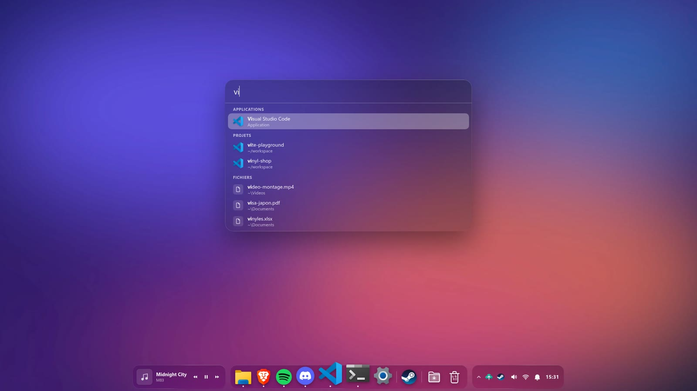
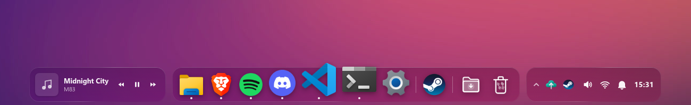
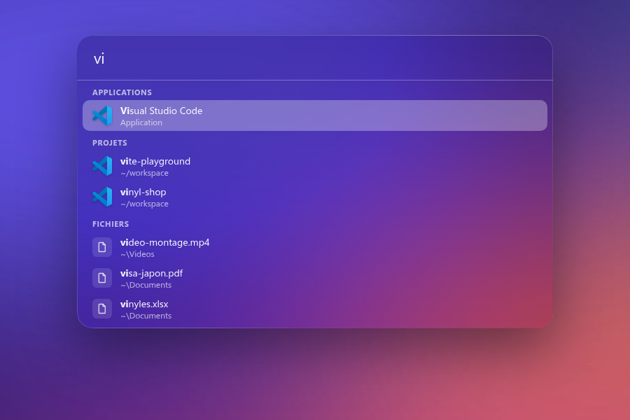
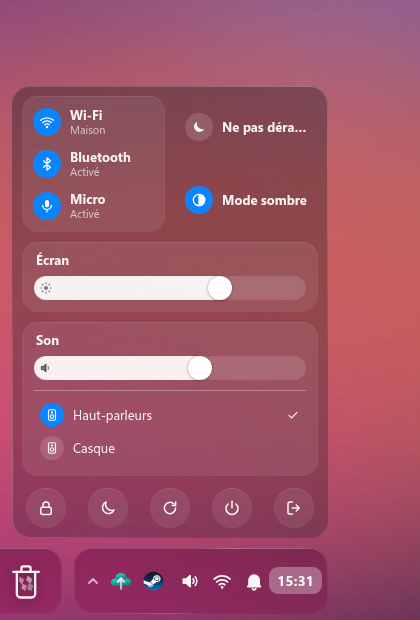
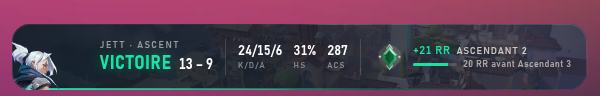

<p align="center"></p>

<h1 align="center">Lucent</h1>

<p align="center"><b>Windows, finally beautiful.</b></p>

**A macOS-style dock, launcher and window toolkit for Windows.** Lucent replaces the
Windows taskbar with a floating glass dock, adds a Spotlight-like search, an app switcher,
a window overview, window snapping, a control center and a Game Mode that gets out of the
way while you play.

[Français](README.fr.md) · [Download](../../releases/latest) · [License: GPL-3.0](LICENSE)

> The interface is currently in **French only**. Translations are welcome, see
> [CONTRIBUTING.md](CONTRIBUTING.md).

<p align="center"></p>
<p align="center"><sub>Screenshots use demo data.</sub></p>

## Features

**Dock**



- Floating glass islands (native Windows composition blur), one dock per monitor, bottom,
  left or right.
- Pinned and running apps with real high-resolution icons, magnification, drag to reorder,
  drop files on an icon to open them with that app.
- Live window previews on hover, Downloads stack, trash with "Empty".
- System tray icons, volume, network and clock inside the dock; media controls for the
  current song.
- Auto-hide with configurable delays, or **always visible** (it then reserves its strip of
  the screen like a taskbar, and still hides over fullscreen apps and games).
- Hides the Windows taskbar safely: a watchdog process puts it back if Lucent is
  killed or crashes, and the uninstaller restores it too.

**Search** (`Alt+Space`)



- Apps, files, WSL projects (opened in VS Code), recent items.
- Calculator, web search (`? query`), power commands (lock, sleep, restart...), `kill app`.
- Clipboard history (`cb`), emoji picker (`:smile`), Quick Look preview (`Shift+Space`).

**Windows**
- App switcher grouped by app (`Alt+²`, i.e. `Alt` + the key above `Tab` on an AZERTY
  keyboard; configurable).
- Window overview, Mission Control style (`Ctrl+Alt+Space`).
- Snapping: `Ctrl+Alt+←/→` halves, `↑` maximize, `↓` center, `D/F/G` thirds,
  `+Shift+←/→` move to the next monitor.
- **Every shortcut is yours**: Réglages → Raccourcis, click a shortcut and press the new
  keys (conflicts are flagged, ↺ restores the default).
- Hot corners (overview, desktop, lock, search, switcher).

**Control center** (click the clock)



- Wi-Fi, Bluetooth, microphone mute, dark mode, monitor brightness (DDC/CI), volume and
  audio output, power menu.
- **Shared monitor**: switch a monitor plugged into two computers to the other PC's input
  (DDC/CI), with a hotkey (`Ctrl+Alt+O`). The monitor leaves this PC's desktop while it
  shows the other one, so windows and the cursor stay on your other screens.

**Game Mode**



- Detects games (Steam, Epic, Riot libraries, plus your own list), keeps the dock and hotkeys out of
  the way, optional High performance power plan, a small system monitor pill (CPU, GPU,
  RAM, ping) on the other monitors.
- **Valorant**: a post-match card in the dock (map, agent, score, K/D/A, HS %, ACS, RR and
  progress to the next rank), and your rank and last matches in search (`valo`). Needs a
  free [HenrikDev API key](https://docs.henrikdev.xyz/).

**Reliability**
- Relaunches itself after a crash, waits for the shell at sign-in, writes a log to
  `%LOCALAPPDATA%\Lucent\logs\lucent.log`.

## Install

1. Download `Lucent_x.y.z_x64-setup.exe` from the [latest release](../../releases/latest).
2. Run it. The installer is per-user (no admin rights). The installer is not code-signed
   yet, so Windows SmartScreen may warn you: "More info" → "Run anyway".
3. Lucent starts at sign-in by default. Right-click the dock → Réglages (settings) to
   configure it.

**Requirements:** Windows 11 (developed and tested on it; Windows 10 1903+ may work),
the Microsoft Edge WebView2 Runtime (preinstalled on Windows 11).

**Uninstall:** Settings → Apps → Lucent → Uninstall. The Windows taskbar comes back.
If it ever stays hidden, run `lucent.exe --restore-taskbar` from the install folder
(`%LOCALAPPDATA%\Lucent`), or turn off "Automatically hide the taskbar" in Windows
settings.

## Privacy

Lucent has no telemetry and no account. It only goes online for features you turn on:

- Valorant: `api.henrikdev.xyz` (your Riot ID and your own API key) and
  `valorant-api.com` (map, agent and rank pictures).
- Web search: the search URL you configure (Google by default), opened in your browser.

Settings live in `%APPDATA%\Lucent\settings.json`, caches and logs in
`%LOCALAPPDATA%\Lucent`.

## Build from source

Lucent is a [Tauri 2](https://tauri.app/) app: Rust core (Windows integration) and a
TypeScript/HTML/CSS interface, no frontend framework.

Prerequisites (on Windows): [Rust](https://rustup.rs/) (stable, MSVC toolchain),
[Node.js](https://nodejs.org/) 20+, the
[Tauri prerequisites](https://tauri.app/start/prerequisites/) (Visual Studio Build Tools,
WebView2).

```powershell
npm ci
npm run tauri dev      # run in development mode
npm run tauri build    # installer in src-tauri\target\release\bundle\nsis
```

Tests:

```powershell
npm test                              # frontend (Vitest)
npx tsc --noEmit                      # type check
cd src-tauri; cargo test              # Rust
```

Note: debug builds do not register the autostart entry. To test the taskbar watchdog,
start the built exe directly (a dev runner's job object kills the watchdog with the app).

### Project layout

| Path | What |
| --- | --- |
| `src-tauri/src/` | Rust core: dock windows, taskbar guard and watchdog, hotkeys, search index, game mode, Valorant, DDC/CI, tray host |
| `src/dock/`, `src/search/`, `src/settings/`... | One page per window (dock, search, settings, switcher, overview, thumbnails) |
| `src/shared/` | Types mirrored from Rust, IPC wrapper, French strings (`i18n.ts`) |
| `docs/decisions.md` | Design decisions (glass rendering, regions, magnification) |

## Contributing

Bug reports, ideas and pull requests are welcome. Read [CONTRIBUTING.md](CONTRIBUTING.md)
first. When reporting a bug, attach the end of
`%LOCALAPPDATA%\Lucent\logs\lucent.log`.

## License

Lucent is free software: you can redistribute it and/or modify it under the terms of
the GNU General Public License as published by the Free Software Foundation, either
version 3 of the License, or (at your option) any later version. See [LICENSE](LICENSE).

Lucent is not affiliated with Apple, Microsoft or Riot Games. Valorant data comes from
the unofficial HenrikDev API and valorant-api.com.
